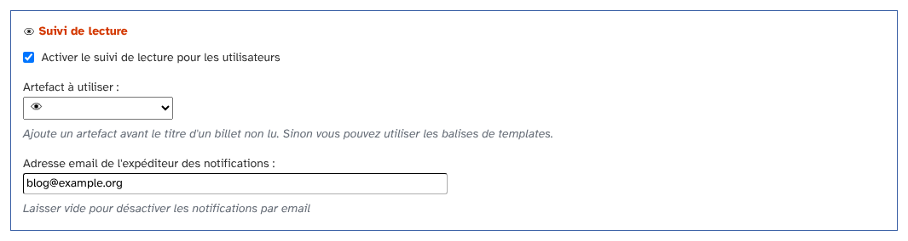
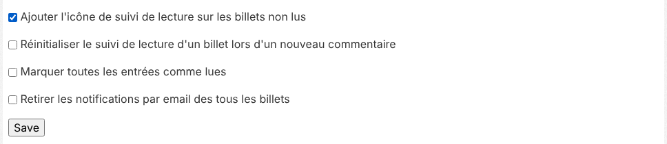
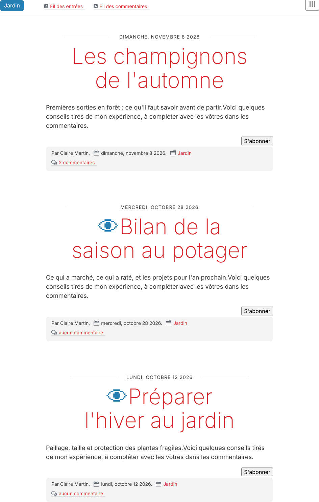
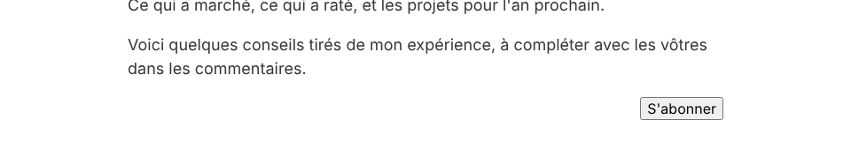
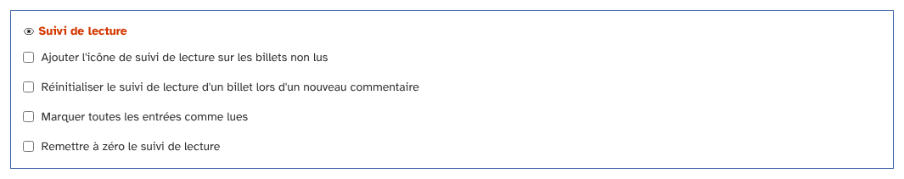

# ReadingTracking : guide d'utilisation

ReadingTracking retient les billets que chaque personne connectée a déjà lus. Il peut afficher une icône devant les titres des billets non lus et envoyer un e-mail quand un billet suivi reçoit un nouveau commentaire.

Le plugin a besoin du plugin FrontendSession : seuls les comptes qui peuvent se connecter sur le blog sont suivis.

## Sommaire

* [Activer le suivi sur le blog](#activer-le-suivi-sur-le-blog)
* [Donner le droit aux utilisateurs](#donner-le-droit-aux-utilisateurs)
* [Les réglages d'une personne connectée](#les-réglages-dune-personne-connectée)
* [Les billets non lus](#les-billets-non-lus)
* [Être prévenu des nouveaux commentaires](#être-prévenu-des-nouveaux-commentaires)
* [Les réglages dans l'administration](#les-réglages-dans-ladministration)
* [Pour les thèmes](#pour-les-thèmes)
* [Bon à savoir](#bon-à-savoir)

## Activer le suivi sur le blog

1. Allez dans « Paramètres du blog ».
2. Ouvrez « Paramètres des plugins pour ce blog ».
3. Dans la section « Suivi de lecture », cochez « Activer le suivi de lecture pour les utilisateurs ».
4. Choisissez l'« Artefact à utiliser », c'est-à-dire le symbole placé devant le titre des billets non lus. Le choix « Ne pas utiliser l'artefact » supprime le symbole.
5. Si vous voulez les notifications par e-mail, saisissez l'adresse d'expéditeur. Laissez le champ vide pour les désactiver.
6. Enregistrez.

## Donner le droit aux utilisateurs

Le suivi est réservé aux comptes qui ont la permission « Suivi de lecture » sur le blog. Donnez-la depuis la fiche de l'utilisateur, en plus de la permission du plugin FrontendSession.

## Les réglages d'une personne connectée

Une fois connectée, une personne ouvre la page « Mon compte » du blog. La section « Suivi de lecture » propose quatre cases :

* « Ajouter l'icône de suivi de lecture sur les billets non lus » : sans cette case, rien n'est affiché.
* « Réinitialiser le suivi de lecture d'un billet lors d'un nouveau commentaire » : un billet déjà lu redevient non lu quand il reçoit un commentaire.
* « Marquer toutes les entrées comme lues ».
* « Retirer les notifications par email des tous les billets ».

Cliquez sur « Save » pour enregistrer. Le blog confirme avec « Profil successfully updated. ».

Quand vous changez la case des commentaires, les billets déjà lus sont conservés et suivent le nouveau mode.

## Les billets non lus

Un billet est marqué comme lu quand la personne connectée ouvre sa page.

L'icône apparaît devant le titre des billets non lus dans ces pages :

* les catégories ;
* les mots-clés ;
* les archives ;
* les résultats de recherche.

Les billets déjà lus n'ont pas d'icône.

## Être prévenu des nouveaux commentaires

Sous un billet qui accepte les commentaires, une personne connectée voit le bouton « S'abonner ». Un clic l'abonne au billet, et le bouton devient « Se désabonner ».

Quand un nouveau commentaire publié arrive, chaque abonné reçoit un e-mail avec :

* le titre du billet ;
* son adresse ;
* un remerciement personnalisé.

La personne qui a posté le commentaire ne reçoit pas l'e-mail.

Pour se désabonner de tous les billets d'un coup, cochez « Retirer les notifications par email des tous les billets » dans « Mon compte ».

## Les réglages dans l'administration

Dans l'administration, chaque utilisateur retrouve les mêmes réglages dans « Mes préférences ». Un super administrateur peut aussi les modifier depuis la fiche d'un utilisateur.

La dernière case, « Remettre à zéro le suivi de lecture », efface tout ce que la personne a déjà lu.

## Pour les thèmes

Si votre thème est personnalisé, vous pouvez placer le symbole vous-même, avec ces éléments dans les gabarits :

* `<tpl:ReadingTrackingIf is_read="0">…</tpl:ReadingTrackingIf>` : affiche son contenu pour un billet non lu. Avec `is_read="1"`, pour un billet lu.
* `<tpl:ReadingTrackingIf use_artifact="1">…</tpl:ReadingTrackingIf>` : affiche son contenu si la personne a choisi d'avoir l'icône.
* `{{tpl:ReadingTrackingArtifact}}` : affiche le symbole choisi dans les réglages du blog.

## Bon à savoir

* L'icône n'apparaît pas sur la page d'accueil du blog, seulement sur les pages listées plus haut.
* Le bouton « S'abonner » est aussi affiché sous chaque billet dans les listes (catégories, archives).
* Les e-mails ne partent que pour les commentaires créés et publiés directement depuis le blog.
* Une partie du texte vient du plugin FrontendSession : le bouton « Save » et le message « Profil successfully updated. » restent en anglais.
